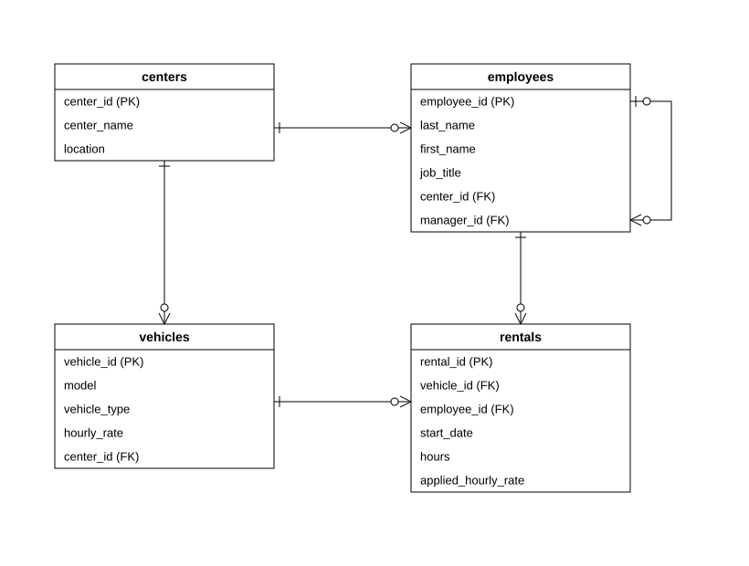

# Oracle SQL Rental Analytics

An academic Oracle SQL project for a bicycle and scooter rental network with three tourist locations: Mamaia, Eforie and Costinesti, Romania. It uses a small relational schema to answer questions about rentals, revenue, vehicle usage and the employee hierarchy.

The project contains **14 queries**: two hierarchical queries, six queries combining joins, subqueries and aggregation, and six analytic queries. This English version keeps the original query logic, sample IDs, dates and amounts.

## Schema and sample data

[Edit the diagram in draw.io](docs/schema.drawio).

| Table | Purpose | Sample rows |
|---|---|---:|
| `centers` | Rental locations and their names. | 3 |
| `employees` | Staff, assigned centers and reporting relationships. | 10 |
| `vehicles` | Bicycles and scooters, their centers and catalog hourly rates. | 12 |
| `rentals` | The vehicle, recording employee, start time, duration and applied rate for each rental. | 30 |

Primary keys identify records. Foreign keys connect the tables, including the self-reference from `employees.manager_id` to `employees.employee_id`. Required fields use `NOT NULL`; duration and rates must be positive. The director has no manager, so `manager_id` is nullable.

Each rental amount is `hours * applied_hourly_rate`, in **RON**. The applied rate is stored on the rental as a snapshot; revenue calculations do not depend on the vehicle's current catalog rate. The fictional sample covers September 1-3, 2026 and includes rented and unused vehicles, fractional hours and equal revenue totals.

## Run in Oracle SQL Developer

1. Connect to an Oracle schema where you can create tables, and open [rental_analytics.sql](rental_analytics.sql).
2. On the first run, use **Run Script (F5)** to create the four tables, insert the sample data, commit it and execute the verification and analysis queries.
3. Check that the verification query reports **3 centers, 10 employees, 12 vehicles and 30 rentals**.
4. For individual result grids, select a complete `SELECT` statement and use **Run Statement (F9)**.

The English table names can coexist with the original Romanian project tables. If these English tables are already populated, run only the verification and analysis `SELECT` statements. Repeating the creation and inserts produces existing-object or duplicate-key errors. The script does not drop or reset tables.

## Query catalog

The IDs below match the comments in the SQL script.

| ID | Question answered |
|---|---|
| H1 | Trace the director and all subordinates, including each employee's level, root director and hierarchy path. |
| H2 | Follow employee 7's reporting chain upward, excluding the starting employee. |
| C1 | Find centers with at least 10 rentals and total revenue above 500 RON. |
| C2 | Find vehicles with at least one rental lasting four hours or more and revenue above 100 RON from all their rentals. |
| C3 | Find centers where every vehicle has been rented at least once, with rental counts and total revenue. |
| C4 | Find employees with at least three rentals, including a scooter rental, and summarize all their rentals. |
| C5 | Find unused vehicles in centers whose total revenue exceeds 500 RON. |
| C6 | List rentals longer than two hours recorded by employees with at least five rentals of any duration. |
| A1 | Calculate the mean amount of the current rental and the two preceding rentals within its center. |
| A2 | Calculate chronological cumulative rental revenue separately for each center. |
| A3 | Count vehicles in the same center whose hourly rates are within 5 RON of the current vehicle's rate, including both limits. |
| A4 | Show each vehicle's hourly rate alongside the minimum and maximum rates across its entire center. |
| A5 | Rank rented vehicles by total revenue within each center, assigning the same rank to equal totals. |
| A6 | Show each rental amount and the preceding rental amount for the same vehicle. |

## How to read the analytic queries

`PARTITION BY` defines which center or vehicle a calculation belongs to. `ORDER BY` inside `OVER` establishes the order used by the calculation; the final `ORDER BY` controls the displayed result.

- **`ROWS`** counts positions: A1 includes the current row and up to two preceding rows; A2 includes all rows from the start of the center's partition to the current row.
- **`RANGE`** uses values: A3 counts rates in the inclusive interval from the current rate minus 5 to the current rate plus 5; A4 explicitly includes the whole partition.
- **`RANK`** operates on the aggregated vehicle revenues: Eforie has two vehicles ranked first, followed by ranks 3 and 4.
- **`LAG`** retrieves the previous amount within the same vehicle; its first rental has a `NULL` previous amount.

Oracle `DATE` stores time as well as the date. SQL Developer may display only the date, although these queries use the stored times. Rental 11 at 12:00 therefore comes before rental 10 at 13:00 in the chronological center calculations.

## Results and validation

See [expected results](docs/expected-results.md) for row counts, numeric checkpoints and a short list of queries to capture manually in SQL Developer.

The original version was executed in Oracle SQL Developer. Expected numeric results were independently recomputed from the sample data. The English translation has not yet been rerun in Oracle; local comparisons verify that the renamed script preserves the original statements and results. Fresh Oracle captures should be taken after running this version.
