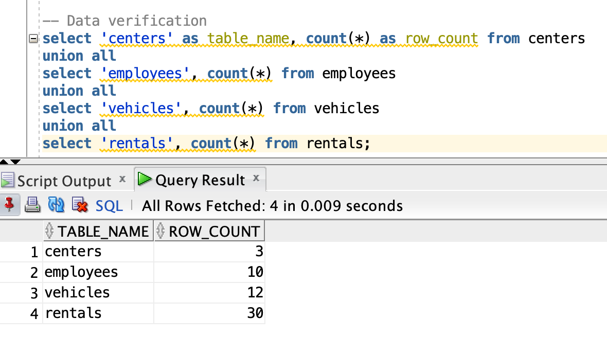
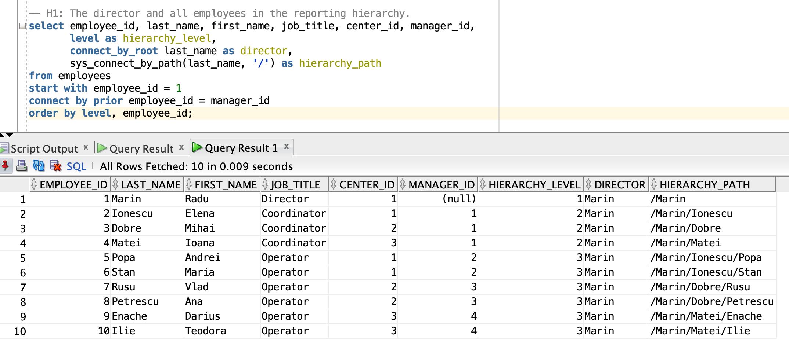
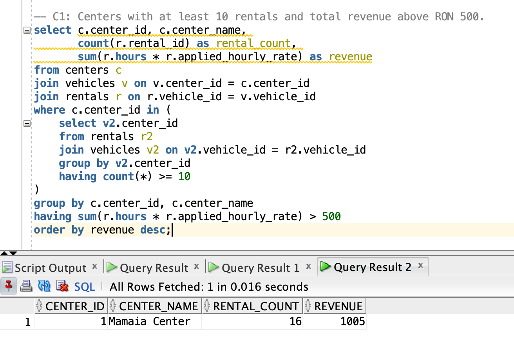
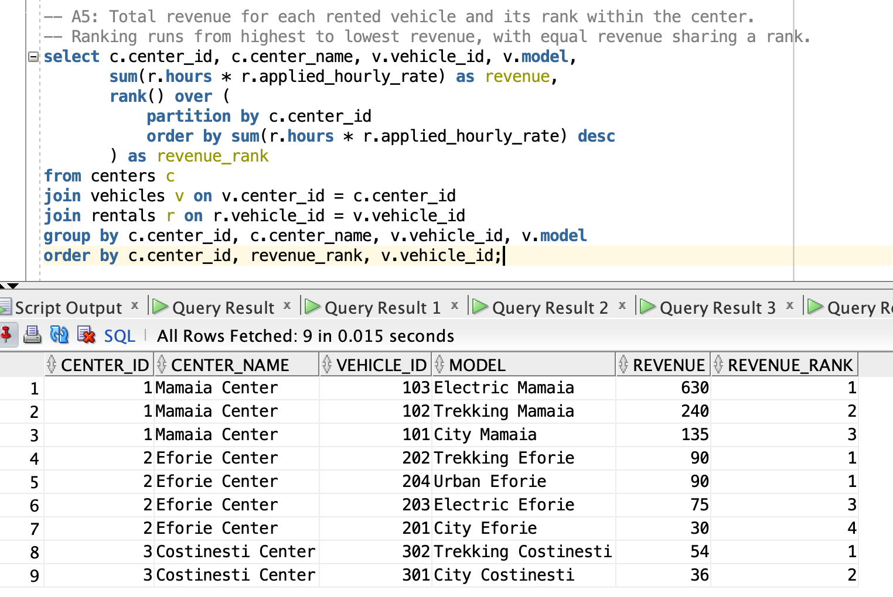
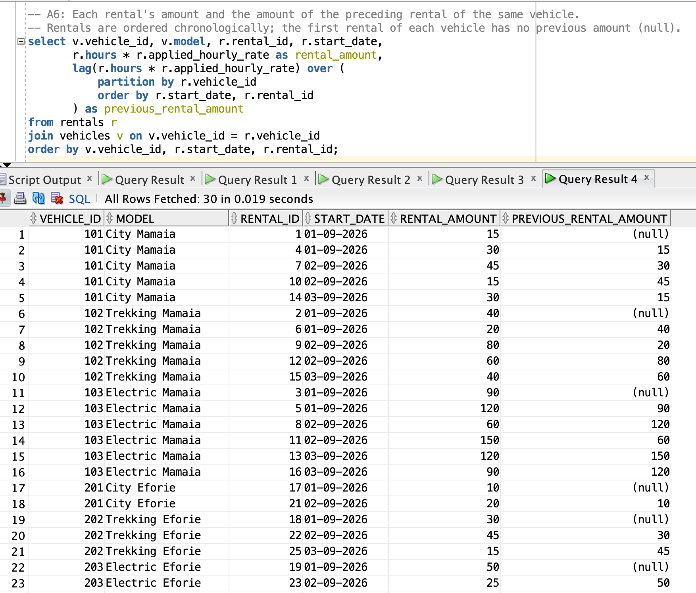

# Query results

Screenshots from Oracle SQL Developer.

## Data verification

The sample data contains 3 centers, 10 employees, 12 vehicles and 30 rentals.

## H1: Employee hierarchy

The director, three coordinators and six operators form a three-level hierarchy.

## C1: Center revenue

Mamaia meets both conditions: at least 10 rentals and revenue above 500 RON.

## A5: Vehicle revenue ranking

Vehicles are ranked by revenue within each center. Eforie's equal totals share rank 1, followed by ranks 3 and 4.

## A6: Previous rental amount

`LAG` returns the preceding rental amount for each vehicle; its first rental has no previous amount.

